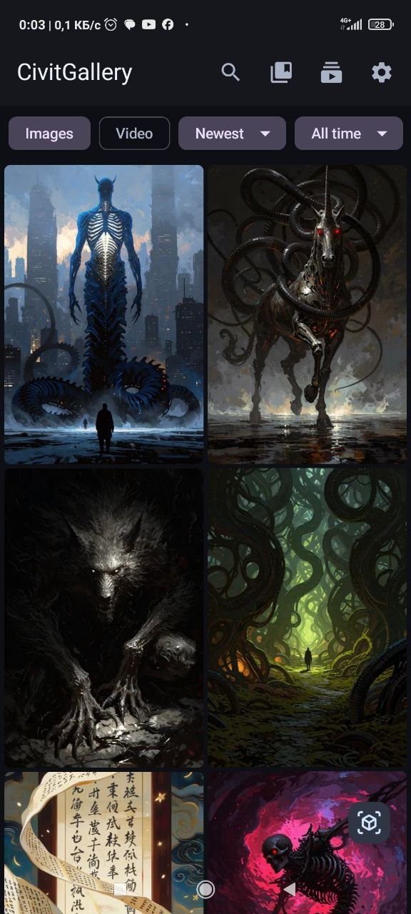
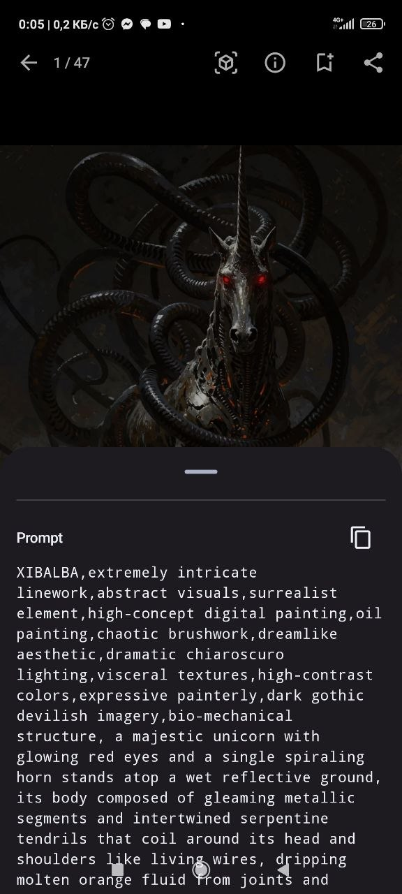
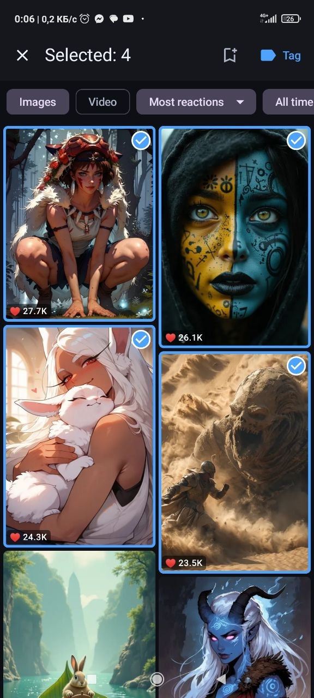

# CivitGallery

Android gallery for browsing images and videos from Civitai.

**[Download the latest APK](https://github.com/greyowlsteam/CivitGallery/releases/latest/download/CivitGallery.apk)** · [All releases](https://github.com/greyowlsteam/CivitGallery/releases)

Scan with your phone camera to download · Наведите камеру телефона, чтобы скачать

[Описание на русском ↓](#civitgallery-ru)

  
  
  
  

## Features

- **Feed** of images and videos from Civitai: sort by reactions, comments or date, by period, by base model (SDXL, Pony, Flux…). Tile size to your taste.
- **Viewer** with swipe and zoom. Under each image: author, models and LoRAs used, **prompt and generation parameters** — copy one field or everything at once in A1111 format.
- **Feeds by author, tag, model and post** — one tap from the image info.
- **Search** for models, authors and collections; model card with versions, trigger words and files.
- **Safe by default:** adult content is blurred and not even downloaded until you tap "Show". Choose which ratings (PG … XXX) to see at all.
- **Hide** tags and authors you don't want to see.
- **Sign in with Civitai (optional)** — on Civitai's own page, your password never passes through the app. Then: reactions 👍❤️😂😢, follows and a "Following" feed, tag voting, your collections — add one image or a whole selection at once.
- **Extended tags:** add your own tags to any image, vote on them, hide or blur images by them.
- **VR mode** for Cardboard-type headsets: browse feeds with your gaze, 3D for stereo pairs and ordinary pictures, 360° panoramas, videos, adding to collections. **[How to use VR](VR.md#en)**
- **English and Russian** interface. No ads, no analytics, no trackers.

*CivitGallery is an unofficial app. It is not affiliated with or endorsed by Civitai.*

Made by the **Grey Owls** team 🦉🦉 — [greyowlsteam.github.io](https://greyowlsteam.github.io/en/)

## Install

Android 8.0 or newer.

1. Download `CivitGallery.apk` on your phone and open it (from the download notification or the Downloads folder).
2. Android asks to allow installing apps from your browser: tap **Settings**, turn on **Allow from this source**, go back.
3. Tap **Install**.
4. **Google Play Protect** checks the app during installation. Keep it turned on and allow the scan.

### Safety warnings

When you download the file, your browser or Android may warn that installing from unknown sources can be dangerous. This is a general warning: it applies to all apps made by independent developers and distributed through independent channels, not to CivitGallery specifically.

Every installation, even from an unknown source, is checked by Google Play Protect, and its result is the main sign that an app is safe to use. With Play Protect on, you stay protected.
The app needs only network access, and every release lists the SHA-256 of the APK so you can check your download.

### Updates

The app checks for a new version once a day (and in Settings → About). Tap **Update**, the APK downloads in your browser —
install it over the current version the same way. Your settings and sign-in stay.

## Privacy

No ads, analytics or trackers. You don't need an account to browse.

**Only on your phone:** theme, tile size and feed filters, the image cache, sign-in tokens (encrypted with a key in Android Keystore).
App data is excluded from Android backups.

**Civitai** (civitai.com): images and their data are loaded directly from Civitai. If you sign in with Civitai, you do it on Civitai's own page —
your password never passes through the app. After that your reactions, collections, follows and hidden tags are read and changed
in your Civitai account, under Civitai's privacy policy.

**Our server** (extended tags). After you accept the rules, the app creates a guest profile with:

- a device key — only the public part; the private key is created in Android Keystore and never leaves the phone;
- the phone model name and the interface language;
- your age confirmation and content consents, with the rules version and date;
- a random nickname (`user-123456`) that you can change;
- the tags you add, your votes and reports, and the IDs of the Civitai images they belong to;
- when you hide extended tags, the IDs of those tags and of the images on the feed page, to find which images to hide or blur;
- your app settings: hidden tags and authors, extended tags to hide, ratings, consents and video sound — so they come back after reinstalling;
- only if you link them: your email (the sign-in code is sent by email; only a hash of the code is kept) and your Telegram ID, username and name.

Like any web server, it keeps technical request logs (time, request address, IP address) to run the service and protect it from abuse.

**GitHub:** once a day the app asks GitHub for the latest release. No personal data is sent; GitHub sees your IP address.

**Deleting your data:** Settings → App profile → **Delete profile** deletes your votes, reports, sign-in methods, device keys and saved settings.
Tags you added stay on the images without your name. To remove data from the phone, uninstall the app.
To disconnect Civitai, sign out in Settings → Civitai account.

---

# CivitGallery (RU)

Android-галерея для просмотра картинок и видео с Civitai.

**[Скачать последнюю версию](https://github.com/greyowlsteam/CivitGallery/releases/latest/download/CivitGallery.apk)** · [Все релизы](https://github.com/greyowlsteam/CivitGallery/releases)

## Возможности

- **Лента** картинок и видео с Civitai: сортировка по реакциям, комментариям или дате, за период, по базовой модели (SDXL, Pony, Flux…). Размер плиток — на ваш вкус.
- **Просмотр** со свайпом и зумом. У каждой картинки: автор, модели и LoRA, **промпт и параметры генерации** — копируются по одному или все сразу в формате A1111.
- **Ленты автора, тега, модели и поста** — в одно нажатие из сведений о картинке.
- **Поиск** моделей, авторов и коллекций; карточка модели с версиями, словами-триггерами и файлами.
- **Безопасно по умолчанию:** взрослый контент размыт и даже не загружается, пока не нажмёте «Показать». Можно выбрать, какие рейтинги (PG … XXX) показывать вообще.
- **Скрытие** тегов и авторов, которых не хотите видеть.
- **Вход через Civitai (по желанию)** — на странице самого Civitai, пароль через приложение не проходит. После входа: реакции 👍❤️😂😢, подписки и лента «Подписки», голосование за теги, свои коллекции — по одной картинке или сразу выбранными.
- **Расширенные теги:** свои теги на любую картинку, голосование, скрытие и размытие картинок по ним.
- **VR-режим** для очков типа Cardboard: ленты взглядом, 3D для стереопар и обычных картинок, панорамы 360°, видео, добавление в коллекции. **[Как пользоваться VR](VR.md#ru)**
- Интерфейс на **русском и английском**. Без рекламы, аналитики и трекеров.

*CivitGallery — неофициальное приложение, не связано с Civitai и не одобрено им.*

Сделано командой **«Серые Совы»** 🦉🦉 — [greyowlsteam.github.io](https://greyowlsteam.github.io/)

## Установка

Нужен Android 8.0 или новее.

1. Скачайте `CivitGallery.apk` на телефон и откройте его — из уведомления о загрузке или из папки «Загрузки».
2. Android попросит разрешить установку из браузера: нажмите **Настройки**, включите **Разрешить из этого источника**, вернитесь назад.
3. Нажмите **Установить**.
4. **Play Защита** проверяет приложение при установке. Не отключайте её и разрешите проверку.

### Предупреждения о безопасности

При скачивании файла браузер или Android могут предупредить, что установка из неизвестных источников опасна. Это общее предупреждение: оно относится ко всем приложениям, которые создают независимые разработчики и распространяют по независимым каналам, а не конкретно к CivitGallery.

Любая установка, даже из неизвестного источника, проверяется Play Защитой, и её результат — главный признак того, что приложением можно пользоваться безопасно. С включённой Play Защитой вы остаётесь под защитой.
Приложению нужен только доступ к сети, а в описании каждого релиза есть SHA-256 файла для проверки.

### Обновления

Приложение раз в сутки проверяет новую версию (и по кнопке в «Настройки → О приложении»). Нажмите **Обновить** — APK скачается
в браузере, установите его поверх так же. Настройки и вход сохранятся.

## Конфиденциальность

Без рекламы, аналитики и трекеров. Для просмотра аккаунт не нужен.

**Только на телефоне:** тема, размер плиток и фильтры ленты, кэш картинок, токены входа (зашифрованы ключом в Android Keystore).
Данные приложения не попадают в резервные копии Android.

**Civitai** (civitai.com): картинки и данные о них загружаются напрямую с Civitai. Вход через Civitai происходит на странице самого Civitai —
пароль через приложение не проходит. После входа ваши реакции, коллекции, подписки и скрытые теги читаются и меняются
в вашем аккаунте Civitai, по правилам конфиденциальности Civitai.

**Наш сервер** (расширенные теги). После принятия правил приложение создаёт гостевой профиль, в нём:

- ключ устройства — только открытая часть; закрытый ключ создаётся в Android Keystore и не покидает телефон;
- название модели телефона и язык интерфейса;
- подтверждение возраста и согласия на контент — с версией правил и датой;
- случайный ник (`user-123456`), его можно сменить;
- добавленные вами теги, голоса и жалобы, а также ID картинок Civitai, к которым они относятся;
- если вы скрываете расширенные теги — ID этих тегов и картинок страницы ленты, чтобы найти, какие картинки скрыть или размыть;
- настройки приложения: скрытые теги и авторы, скрываемые расширенные теги, рейтинги, согласия и звук видео — чтобы они вернулись после переустановки;
- только если вы их привяжете: почта (код входа приходит письмом, хранится только хэш кода) и ID, имя пользователя и имя в Telegram.

Как любой веб-сервер, он сохраняет технические журналы запросов (время, адрес запроса, IP-адрес) для работы и защиты от злоупотреблений.

**GitHub:** раз в сутки приложение спрашивает у GitHub последнюю версию. Личные данные не передаются, GitHub видит ваш IP-адрес.

**Удаление данных:** «Настройки → Профиль приложения → **Удалить профиль**» удаляет голоса, жалобы, способы входа, ключи устройств и сохранённые настройки.
Добавленные теги остаются на картинках без вашего имени. Чтобы удалить данные с телефона, удалите приложение.
Отключить Civitai — выйти из аккаунта в «Настройки → Аккаунт Civitai».
